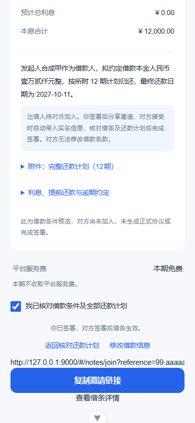
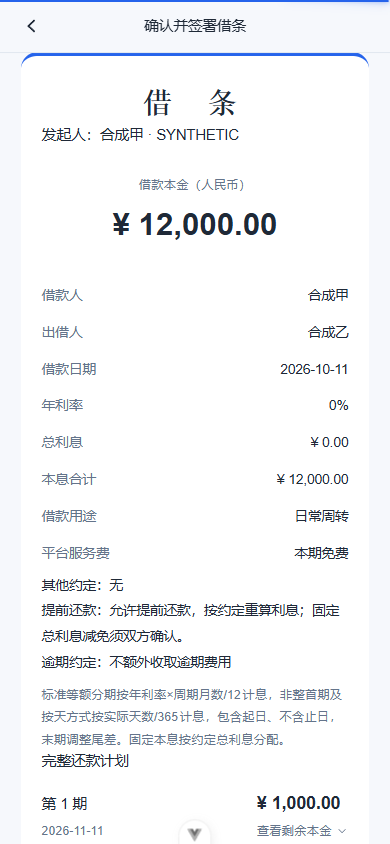
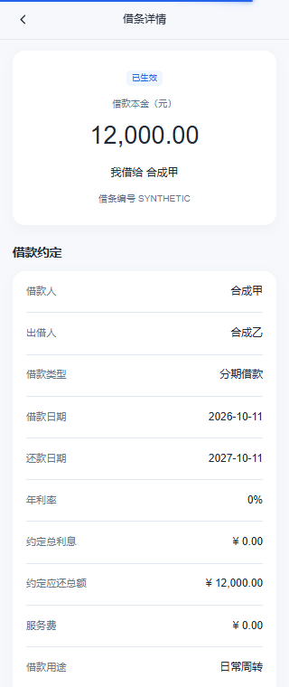

# 电子借条发起与自建手写签署

更新：2026-10-11。本期已按用户确认改为自建手写签署，只使用现有登录和实名资料，不增加密码二次确认、短信或第三方签署供应商；本期免费。

## 当前流程

填写条件→服务端试算→保存完整草稿并预览→本人手写签署→分享开放链接→另一位实名用户核对全部条件并手写签署→补齐对方身份、生成最终借条并生效。

打开链接不写对方身份。没有指定接受人、链接业务有效期、领取次数或发起人二次确认。签署提交使用主表行锁、版本号和预览摘要；多人同时签时只有一位成功。发起人不能签另一侧，已完成和已取消的链接不能继续接受。

自建签署记录的是登录实名用户的明确确认和手写图片，并以服务端HMAC封存凭证；这不是CA证书签名，不做笔迹真实性自动鉴定。系统不因完成签署而记录资金已交付或实际还款已完成。

## 已实现接口

用户接口均需现有H5登录权限及实名状态，前缀`/api/iou/app`。

| 方法/路径 | 行为 |
| --- | --- |
| GET /note-options | 还款方式、限额、计息版本、免费策略、创建及签署开关。 |
| POST /notes/quote | 计算六种方式；不落库。 |
| POST /notes | 创建完整草稿，Idempotency-Key必填；本人身份服务端填充，另一方NULL。 |
| PUT /notes/{id} | `{version,conditions}`替换未签草稿，重算并整体替换计划。 |
| DELETE /notes/{id}?version=… | 删除本人未锁定草稿或本人发起的已取消借条及所有计划，重复删除204。校验当前版本，其他状态不可删除。 |
| GET /notes/{id} | 已有详情接口扩展条件、计划、version、stage、actions。 |
| GET /notes/{id}/plan | 完整约定计划；余额为计划余额。 |
| GET /notes/{id}/preview | 条款、完整计划、条款hash、本次用户预览hash与版本。 |
| POST /notes/{id}/signatures | 同步手写签署，提交成功返回200及借条详情。 |
| GET /notes/{id}/signatures/current | 当事人查看本人签署结果；无需供应商会话或候选人轮询。 |
| GET /notes/{id}/share | 发起人取得待对方签署借条的可重复使用分享定位串。 |
| GET /shared-notes/{reference} | 已登录实名持链接者核对条件和本人拟加入身份；只读。 |
| POST /notes/{id}/cancel | `{version,reason}`；本人取消未完成双方签署的借条。 |
| GET /notes/{id}/agreement | 鉴权及文件SHA256校验后下载最终HTML借条；disposition=inline/download。 |
| GET /notes、GET /summary | 原本人列表和生效本金统计保留；列表追加stage/version/legacy。 |

金额和ID使用字符串。conditions字段和六种算法见[详细方案](./电子借条业务接口方案.md)，服务端BigDecimal计算为正式来源；H5本地试算仅用于填写时反馈。标准分期2至60期、周期1/3个月；技术受理限额由`iou.notes`配置，不作为对借款条款效力的判断。

签署请求示例：

```json
{
  "version": "0",
  "previewHash": "服务端本次预览返回的SHA256",
  "confirmed": true,
  "signatureImage": "data:image/png;base64,手写PNG数据",
  "shareReference": "对方签署时提供，发起人可省略"
}
```

同时发送Idempotency-Key。只接受受限尺寸PNG，先读尺寸再解码、检查非空笔画、重新编码去除原始附带内容。图片不等于可由客户端指定签署人；服务端始终使用当前登录人的已核验身份。

同一签署操作的网络重试保留key、图片及原预览摘要。签署成功后同一操作返回原结果，不重复生成文件；已被其他人签署返回409。版本或预览冲突需重新核对，不能自动重新确认。前端不自动重试签署。

## 条款、文件与事务

- 草稿允许本人切换角色，服务端显式清空原侧三个身份字段并填入新侧，不能依赖MyBatis默认忽略NULL更新。
- 创建幂等依赖主表唯一索引；主表和全部计划同事务保存，删除先处理计划外键。
- 用户端草稿禁止通过后台CRUD单独改金额或日期，避免计划失配；必须走用户业务服务。
- 签署前核对主表条件与正式计算出的计划、总额和版本一致，首次签署时固定条款快照和hash。
- 发起人原签HTML、签名PNG及凭证JSON保持原样；另一方加入后另存对方文件和最终HTML，以原签文件hash关联。
- 本方签署、对方身份绑定、双方成功状态和最终文件信息由一次事务提交。文件先保存到私有目录；数据库事务回滚时删除本次文件。
- 服务端HMAC凭证包含身份HMAC与密文快照、签名图片hash、条款hash、签署时间、请求编号、直接连接IP和User-Agent。普通详情不返回这些内部内容。
- 不存身份证明文到日志、地址栏、浏览器存储或普通签署文件；签名图片也不写入浏览器持久存储。
- 文件下载只给正式当事人，分享访问者在未签时不能下载最终借条。下载响应no-store，设置HTML内容限制策略，不返回内部文件路径。
- 最终文件目前为可打印的HTML，包含双方签名和还款计划；尚未提供PDF导出。HTML打开后可使用浏览器打印。

## 配置与数据库

主表追加fixed_interest_amount、create_request_key、create_request_hash、active_sign_context四列，增加UNIQUE(creator_user_id,create_request_key)。active_sign_context实际保存双方同步手写签署的幂等与凭证上下文，不是异步候选人占位；不新增业务表。

已有库先执行`sql/iou_note_initiation_migration.sql`，再执行`sql/iou_note_business_migration.sql`。新库使用更新后的主表和计划表初始化脚本。业务迁移已在开发库执行，DDL前备份位于被Git忽略的`.codex-local/`。

`application.yml`配置创建/签署开关与本期免费策略。签署还要求环境变量IOU_NOTE_SEAL_KEY至少32字符；未设置密钥时note-options.signingEnabled=false，签署拒绝503。本地已生成随机密钥并保存到被忽略的`.codex-local/env.ps1`，没有输出或提交密钥。

私有文件默认位于运行用户目录`.eladmin/iou-agreements`，可用iou.notes.storage-path覆盖。该目录、数据库与封存密钥需要共同备份。分享定位串没有业务到期时间；当前依赖稳定密钥，直接换密钥会使旧链接失效，多密钥轮换尚未实现。

## H5 联调

- 发起页面第一步向服务端请求quote；第二步进入预览时创建/更新草稿并读取preview。
- 可从详情“继续填写并签署”恢复完整草稿。未填完的半成品仍为页面内存内容，不写数据库占位值。
- 第三步核对勾选并手写本人姓名，提交成功后显示邀请链接。
- 分享使用实际H5路由生成`/#/notes/join?reference=…`，适配项目哈希路由；匿名用户登录后返回原链接。
- 对方页面展示原条件、本人拟加入身份和完整计划，没有修改入口；签名提交成功跳转本人借条详情。
- 详情支持完整计划、草稿删除、未完成借条撤销、复制链接和最终HTML下载。已签后不展示修改入口。

## 验证记录

- 49项后端聚焦测试通过，覆盖六种方式、月底/闰年/季度、非整首期、无息及零利率恢复、微小利息和本金尾差、身份来源、创建/签署幂等、锁定、越权与文件完整性。
- 独立Spring/MyBatis服务上下文连接开发MySQL，合成身份验证事务保存、角色切换NULL更新、双方签署、最终文件读取、重复签署及草稿删除；整段测试事务回滚并清理测试文件。
- 两名合成对方同时在独立事务提交同一借条签署，实际行锁验证只有一名成功，另一名业务冲突；专用合成账号、借条、计划和文件均已清理。
- 19项H5计算及金额传输测试、类型检查、ESLint、Stylelint及生产构建通过。浏览器隔离上下文通过合成接口响应验证两次手写提交、正确分享路由、最终详情及320px无横向溢出；没有使用用户真实会话写入。
- 后端通过scripts/start-dev.ps1重启，匿名业务接口401。未开放收费、实际还款流水、提前结清执行、展期和资金转移。

截图仅包含合成身份与金额：






