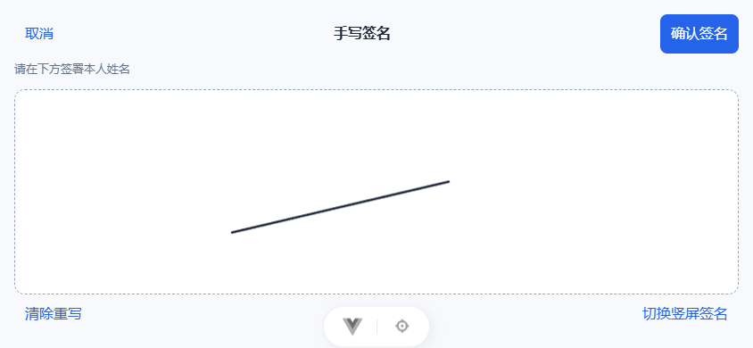
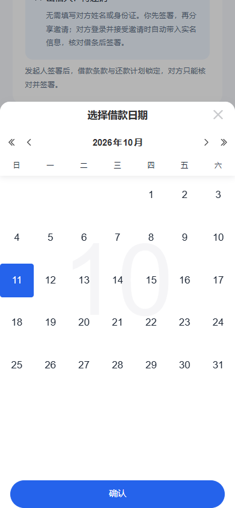

# 电子借条发起页面

## 日期弹层高度（2026-10-11）

单月切换的日期选择器按实际月份内容确定弹层高度，确认按钮紧随日期区，避免 Vant 默认 80% 高度产生的大段空白。弹层最高为可视高度的 85%，矮屏仅滚动日期区，保留底部确认和安全区。连续月份滚动模式保持原有布局。

已通过组件浏览器验证：390×844 下日期区至底部按钮区间距为 0；320×480 下弹层高 408px，无横向溢出，确认按钮可见且确认后的日期值正确。类型、ESLint、Stylelint与生产构建通过。


2026-10-11更新：真实业务接口与自建手写签署已接入，本期免费。当前流程、接口和截图见[发起接口实现](./电子借条发起接口实现.md)。以下保留此前仅填写预览阶段的设计记录，其“尚未开放”描述不再代表当前状态。

## 签署成功与邀请交互（2026-10-11）

- 发起人签署成功后显示独立结果页，展示“你已签署，等待对方签署”、金额、本人身份和借条编号；隐藏填写步骤、旧预览说明、勾选项、签名、草稿及修改按钮，返回入口去我的借条。若双方已完成则显示借条已生效。地址保留已签记录定位参数，刷新时重新鉴权查询借条恢复结果，已撤销等状态转详情。
- 主按钮“邀请对方签署”打开邀请弹层，提示发给借款人或出借人，对方打开核对并签署；次按钮“查看借条详情”。详情页复用同一邀请组件，主页面不展示裸链接。
- 支持系统分享时提供“分享邀请”；复制时复制金额、核对说明和邀请链接组成的完整文案。优先使用Clipboard API，内网HTTP不可用或权限拒绝时尝试兼容复制。复制成功显示正常状态提示；复制仍失败才在弹层内展示可长按复制的完整邀请内容。用户取消系统分享不当作错误。
- 签署与获取邀请分开处理。签署接口确认成功后立即进入结果页；邀请获取失败提示重新获取，不能重新签署，也不把签署误报为失败。未知结果签署仍沿用原幂等键重试。
- 独立浏览器使用合成资料和模拟接口验证签署结果、刷新恢复、旧文案与裸链接移除、HTTP复制、详情页再次邀请、邀请失败重试不重复签署、手动复制、系统分享和取消分享。类型检查、ESLint、Stylelint和生产构建通过；未实际发送邀请或签署真实借条。


## 内网 HTTP 操作编号兼容（2026-10-11）

手机通过内网 `http://电脑IP:9000` 访问时，浏览器不提供仅安全上下文可用的 `crypto.randomUUID()`。创建草稿、发起人签署及对方签署统一使用 `createIouRequestId`：原生方法存在时直接使用；不存在时以 `crypto.getRandomValues()` 生成标准 UUID v4。没有安全随机数时提示更换浏览器，不退回时间戳或 `Math.random()`。创建与签署 pending 操作仍沿用原幂等键重试，后端接口不变。

验证：3项操作编号测试通过；真实内网 HTTP 浏览器上下文确认原生 randomUUID 缺失、安全随机数可用，模拟接口验证显式保存、同草稿更新、失败重试同键、签署前保存与条款变化阻断。类型检查、ESLint及生产构建通过，测试不创建或签署真实借条。

## 借款金额必填提示（2026-10-11）

- 金额区域使用浅蓝底完整圆角边框、固定人民币符号与“必填”标签；空值提示“请输入借款金额”，输入值继续以大号字体显示，点击整个输入区域聚焦。保留常用金额及大写金额提示，默认金额留空。
- 点击下一步时若金额漏填或不合法，定位并聚焦金额框，直接在金额区域显示错误；快捷选择或修改后同步更新提示。仅外层圆角区域显示聚焦高亮，移除内层输入控件重复的方形聚焦框。
- 手机尺寸浏览器验证默认留空、漏填定位聚焦、金额格式/限额、快捷金额、大写提示和320px布局通过；错误金额不发送试算或创建请求。类型检查、ESLint、Stylelint和生产构建通过。

## 全屏手写签名（2026-10-11）

- 发起人和对方签署页复用 `IouSignaturePad`。页面仅显示“点击手写签名”或已确认图片及“重新签名”；点击打开大画布，确认后回填，正式签署仍由原页面提交按钮触发。
- 手机尝试浏览器全屏及横屏锁定。接口缺失或拒绝时，自动使用网页内旋转的横向画布；工具栏始终提供竖屏签名切换，无法横握手机也能完成签名。电脑使用大尺寸横向弹窗。全屏弹层覆盖默认弹窗宽度限制，工具栏保持固定尺寸，不随横屏宽度放大。
- 草稿画布与已确认图片分离：取消、清除或重新书写未确认时不覆盖原签名；空白或不符合后端图片限制时不能确认。切换方向、视口变化按比例保留笔迹，旋转坐标反向映射至画布。父页面清空签名时预览同步清空。
- 弹层阻止背景滚动，支持取消、Esc、键盘焦点约束和关闭后恢复入口焦点；仅解除本组件申请的全屏及横屏锁定。PNG尺寸、字节和非空笔迹约束沿用原后端规则，不新增接口、SQL或后端重启。
- 验证：独立 Chrome 手机模拟覆盖接口缺失、全屏失败、横屏锁定被拒绝、320px屏幕触摸书写、横竖切换保留笔迹、清除、取消保留原图、确认才回填及不自动提交；桌面 Esc 和焦点恢复通过。原草稿保存与提交模拟流程回归、25项Node测试、类型检查、ESLint、Stylelint及生产构建通过。测试使用合成资料和模拟接口，没有签署真实借条；未代替 iOS/Android 真机兼容验收。




## 显式保存草稿（2026-10-11）

- “填写信息→核对还款计划→预览借条”仅进行后端试算与页面展示，不创建或更新借条，不再在进入预览时自动保存。
- 在“签署并邀请对方”下方增加“保存草稿”次要按钮，不要求勾选核对或手写签名。首次点击创建草稿，之后修改内容并再次保存更新同一份记录；无修改时显示禁用的“草稿已保存”。保存成功留在预览页，提示可在我的借条中继续填写；保存前不会显示“已保存草稿”。
- 直接签署时先保存当前核对内容，再获取服务端正式预览，核对规范化条款、逐期计划、金额、计算版本与本人姓名均和本次核对一致后，使用正式预览的版本及哈希签署。内容变化时阻止签署并要求返回重新核对。签署状态及权限仍由原后端校验。
- 使用现有试算、创建、更新、预览及签署接口，不新增接口或SQL。未知结果的创建重试沿用相同幂等键，防止重复创建。已签署记录隐藏保存与修改按钮。
- 离开页面仍提示未保存修改，本轮没有自动保存或新增“保存并离开”行为。
- 验证：类型检查、ESLint、Stylelint、23项Node测试及生产构建通过。独立浏览器使用合成资料和模拟接口验证预览零落库、无签名保存、原记录更新、失败重试同键、直接签署前保存及预览变化阻断签署；没有创建或签署真实借条。


## 日期选择优化（2026-10-11）

- 发起页面五处可编辑日期统一复用框架 `VanFieldCalendar`：借款日期、到期还款日期、首期还款/付息日期、自定义计划初始首期日期与逐期还款日期。
- 点击输入框弹出日历，支持按年/月切换；选择后点击确认才回填，关闭弹窗保留原值，再次打开定位到当前日期。展示与接口值均为 `YYYY-MM-DD`。
- 还款日期须晚于借款日期，最大日期取借款日期加接口 `maxTermDays`；自定义中间期须晚于上一期、早于下一期，无可选间隔时提示调整相邻期。修改借款日期不静默覆盖已自定的还款计划；提交前沿用日期递增校验并补充整个期限校验。
- 借款日历默认提供当前年前后十年的浏览范围，历史草稿超出时扩展范围以保持回显；此范围仅用于日历浏览，不新增借款日期业务校验。自动生成的最终还款日期及预览、详情仍为只读展示。
- 验证：H5 类型检查、生产构建、改动文件 ESLint/Stylelint、20项 Node 测试通过；独立浏览器使用合成资料验证五处弹窗、确认/取消/重新打开、历史草稿与320px窄屏，无真实创建或签署请求。构建保留框架既有 PostCSS `from` 参数警告。



## 利息输入优化（2026-10-11）

- 新借条默认本人为出借人、年利率6%，提前还款默认为“双方协商确认结清金额”；已有草稿仍保留原身份与约定。
- 移除独立“无息借款”勾选框。按年利率计息时输入0%表示无息；固定本息方式输入总利息0元表示无息。内部仍保留 `interestFree` 接口字段并自动同步，兼容服务端和已有草稿；空输入不能当作零。
- 提供0%无息、3%、6%、12%快捷选项（超过接口上限的选项不展示），支持每次加减0.5个百分点及手动输入，保留最多六位小数。利率上限读取 `note-options.rateMax`，将服务端比例换算为页面百分数，并沿用页面最高100%的计算边界；超限时提示并阻止进入下一步。后端代码默认配置为1，即100%，本次没有调整业务上限或法律适用规则。
- 固定本息仍填写总利息，不展示年利率控件；修改利率或在0%与有息之间切换时不自动替用户更换还款方式，保持已填写的期数和计划。
- 利率加减改用框架所依赖的Vant `Stepper`，显式设置 `step=0.5`、`integer=false`、`longPress=false`，替换手写加减按钮。桌面点击、手机触摸、先加后减与连续十次往返均按0.5变化，覆盖0.5→1→0.5及六位小数输入；保留超限输入提示，不静默改写历史草稿。
- 验证：类型检查、ESLint、Stylelint、生产构建及22项Node测试通过；独立浏览器用合成资料和8%的测试上限核验默认值、零利率、快捷选项过滤、上下界按钮、超限阻止提交、六位小数、固定利息与320px窄屏，无创建或签署请求。

## 本轮范围

2026-10-11本金输入优化：本金框下方增加1千、5千、1万、5万快捷金额，点击替换当前值，按金额（整数分）同步选中状态；新借条金额仍为空。保留手动输入和两位小数精度，有效金额显示人民币大写；无效或超限金额提示错误。快捷金额按接口 `principalMax` 过滤，提交前补充上限校验。类型检查、ESLint/Stylelint、生产构建与独立浏览器验证通过，覆盖四档选择、12800.50手动输入、10000.00选中1万、6000元测试上限过滤/拦截及320px窄屏；未创建真实借条。

H5 页面位于 `eladmin-h5/apps/iou/src/views/notes/create.vue`，路由为 `/notes/create`，首页蓝色“发起借条”入口进入该页面。沿用乐享借应用主题，不修改后台借条 CRUD。

本轮完成填写、还款试算和借条内容预览。本人信息使用现有 `GET /api/iou/app/me`，要求登录并通过姓名与证件核验。没有新增创建、签署、支付接口，不调用管理员 `/api/iouNote`，不生成真实借条、服务费订单或正式协议文件。

页首说明当前仅能填写和预览，邀请、签署与支付尚未开放；服务费显示“尚未配置”，不假设为零。最终“签署并邀请对方”按钮禁用，勾选核对内容也不会完成签署、创建记录或生成分享链接。预览里的正文仅为借款条件摘要，正式合同与邀请、签署方式另行接入。

## 页面流程

1. **填写信息**：本人借款人/出借人身份、借款本金、日期、用途、备注、还款安排、利息与其他约定；对方显示“待邀请”，不收集对方姓名和身份证。
2. **还款计划**：方式对应金额汇总、逐期日期/本金/利息/本息合计，展开查看剩余本金；提示对方待邀请，平台服务费另行展示。
3. **预览借条**：借条纸张布局、金额大小写、本人姓名、另一方“待对方加入”、利息、最终日期、借款条件摘要及完整还款计划附件。正文使用“拟约定”，不将未知对方显示为已达成借款的当事人。

上一步和返回修改保留本次填写内容；重新进入预览页面需重新勾选核对。离开路由时对有修改的内容提示清除，确认离开后销毁表单。未加载本人资料时展示加载/错误重试，不伪造实名状态。

确定的流程为：发起人填写条件及还款计划→发起人签署→分享开放链接→对方登录并主动接受、核对内容→对方签署成功后补齐实名身份。不增加发起人二次核对或二次确认。发起人签署后锁定金额、利率、日期、用途、备注、其他约定与全部还款计划，对方只能接受并签署，需要修改时重新发起。

页面仍仅支持填写和预览，不实现真实签署或链接生成。不设置邀请有效期或指定接受者；借条未取消且对方尚未签署时，另一位已核验用户可以核对并签署，打开链接本身不会绑定身份。后端须禁止发起人本人作为对方签署并保证只有一人成功绑定。数据库扩展及后台兼容见[电子借条发起数据库调整](./电子借条发起数据库调整.md)，实际签署与并发绑定服务尚未实现。

## 六种还款方式

| 方式 | 输入和展示 |
| --- | --- |
| 到期一次还清 | 借款本金、借款日期、到期日期；生成一期本金加利息。 |
| 等额本息 | 期数、周期、首期日期、年利率；每期本息基本相同，末期调整尾差。 |
| 等额本金 | 每期本金平均分配，末期补齐尾差；利息随剩余本金变化。 |
| 先息后本 | 各期仅支付利息，最后一期支付全部本金与当期利息。 |
| 固定本息 | 本金均分、约定总利息均分；明确其不是按剩余本金计息。 |
| 自定义计划 | 生成平均计划后调整或逐期添加；自定日期、本金，允许零本金期，利息按余额及实际天数试算。 |

标准分期支持每月/每季度、2至60期。无息是独立选项，无息时将等额本息、等额本金和固定本息合并成“本金平均分期”，仍保留先息后本和自定义计划。自定义计划总本金必须与借款本金一致、日期递增、至少两期。

提前还款和逾期项目前只用于预览约定，不表示已经实现还款、重算、逾期费用、展期或结清。固定总利息提前结清的减免需明确确认，不自动照搬金融机构的收费规则。

## 页面试算口径

- 试算工具 `apps/iou/src/utils/iouNotePreview.ts` 只用于展示，不能作为后端正式债权账本。
- 金额输入最多两位小数，计算按整数分处理；页面试算单项金额上限一亿元，正式业务限额和利率范围由后端另行核定。
- 百分数利率最多六位小数；标准月周期用年利率除12，季度为三个月。
- 非整周期首期、一次性、先息后本和自定义计划按实际天数及年利率除365计息，包含起日、不含止日。日期计算使用UTC日历避免夏令时差。
- 等额本息对不同首期利率使用逐期折现因子试算，再以整数分分配本息，最后一期归还剩余本金。正式算法必须在后端复核、版本化并与合同一致。
- 完整周期沿用借款日锚点；例如1月31日对应2月末，下一期回到3月31日。自定义首期则以其约定日生成后续日期。
- 最终还款日期只读生成；各期金额精确到分，尾差在末期处理，固定利息很小时不产生负的末期利息。
- 没有自动调用实时费率、征信或收费身份核验，没有据此判断借贷合法性或宣称合同已经生效。

## 身份与隐私

本人姓名只取现有登录账号资料，不允许用户指定本人关联ID。发起表单与页面草稿模型不包含对方姓名或身份证字段，所有步骤均可在不知道对方身份时完成条件预览，不写入身份数据到地址栏、日志、localStorage、sessionStorage或后端。

未来对方主动接受邀请时由后端读取当前登录账号的实名资料，仅补齐对方身份，不允许其修改已签署的借款条款和还款计划。对方核对完整内容后签署，不要求发起人再次确认。发起人签署内容的版本、对方身份补齐及其签署记录应关联保存。双方是否同一人、邀请有效性和绑定权限、利率与其他约定有效性须在后端创建与确认流程中复核；本轮不会假称对方已核验或已加入。

## 验证记录（2026-10-11）

- H5 `run-h5.ps1 -Task check` 与生产构建通过；构建保留框架原有PostCSS `from` 参数警告。
- 新增15项Node测试，覆盖六种方式、金额精度、月底与闰年、首期非整周期、季度、无息、尾差、自定义本金总和/日期校验及中文金额。
- 新页面、试算工具与组件ESLint及Stylelint通过。
- 浏览器使用独立上下文和合成本人资料响应，验证首页入口、六种方式、身份切换、输入校验、返回修改、退出确认清理与资料失败重试；不借用真实账号会话。邀请页面调整后另行验证不填写对方信息可进入计划和预览，切换身份时正确显示待邀请角色。
- 390px和320px手机尺寸检查，未出现横向溢出。填写到预览只有GET请求，没有创建、支付或签署请求。
- 独立生产构建预览验证匿名访问跳转登录并保留 `/notes/create` redirect；登录用户由首页进入正确的静态发起路由，不落入借条ID详情。
- 真实创建、电子签署、支付、正式合同和服务费配置不属于本轮页面验收。


## 验证命令

在 `eladmin-h5` 目录执行：

```powershell
./scripts/run-h5.ps1 -Task check
./scripts/run-h5.ps1 -Task build
node --test apps/iou/tests/iouNotePreview.test.mjs
```

## 下拉选项组件（2026-10-11）

借款用途、还款周期、提前还款及逾期约定统一使用项目现有 `VanFieldPicker`，移除原生 select。选择器提供标题、取消和确认，确认后更新表单；取消保留原值，每次打开同步当前值（包含草稿恢复后的值），避免上一次未确认的选择影响下次打开。长选项支持换行，字段样式复用日期控件，保持一致。确认、取消、重新打开、四项选择和借条预览经浏览器模拟验证，ESLint、Stylelint、类型检查通过。
