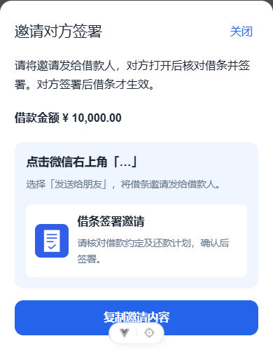

# 电子借条微信邀请卡片

签署结果页、借条详情页共用邀请组件。在微信浏览器内点击邀请，准备卡片后提示通过右上角“…”选择“发送给朋友”；在其他浏览器使用系统分享或复制邀请。JS-SDK 设置的是分享内容，不会直接打开微信好友列表，也不能据此确认用户已发送。

卡片标题为“借条签署邀请”，描述为“请核对借款约定及还款计划，确认后签署。”，不展示姓名、金额。图片是 H5 的 `/wechat-invitation.png`，点击进入对应借条的邀请页面。卡片外观由微信客户端决定，页面中的卡片仅是内容预览。

## 公众号与部署配置

默认关闭，不会在启动或未配置时访问微信接口。公众号准备好后，确认拥有 `updateAppMessageShareData` 权限，配置 JS 接口安全域名及后端出口 IP 白名单。正式 H5 应使用公开可访问的 HTTPS 域名，内网 IP 不能用于正式卡片联调。

后端使用以下环境变量，密钥保留在环境变量或本地加密配置中，不写入前端、仓库、日志：

| 环境变量 | 内容 |
| --- | --- |
| `IOU_WECHAT_ENABLED` | 联调时设为 `true`，默认 `false` |
| `IOU_WECHAT_APP_ID` | 公众号 AppID |
| `IOU_WECHAT_APP_SECRET` | 公众号 AppSecret |
| `IOU_WECHAT_PUBLIC_ORIGIN` | 正式 H5 来源，例如 `https://ajc.tingnichui.com`，不带路径、查询或片段 |
| `IOU_WECHAT_IMAGE_URL` | 可选公开 HTTPS 图片 URL，默认正式来源下的 `/wechat-invitation.png` |

公众号凭据若使用其他服务管理，需协调统一管理；此实现使用微信 `stable_token` 接口、`force_refresh=false`，不主动强制刷新凭据。

## 接口与失败处理

`POST /api/iou/app/notes/{id}/wechat-share`，携带登录 Authorization，JSON 请求为 `{"pageUrl":"https://正式域名/"}`。后端先执行既有邀请权限校验，仅发起人且借条等待对方签署时可获取；客户端不能指定卡片链接或其他借条 reference。

后端对实际页面 URL 去除片段后的原文签名，校验其 HTTPS 来源与配置来源一致，保留查询参数原文。返回公开 AppID、nonce、时间戳、SHA-1 签名及卡片内容，不返回 access_token、ticket 或 AppSecret。响应禁止缓存。

access_token、jsapi_ticket 在单实例内同步缓存并提前 120 秒失效，上游失败退避 30 秒。多实例部署前须将缓存迁移为共享缓存以控制票据请求量。专用 HTTP 客户端日志类别保持 WARN，避免调试日志暴露微信凭据。

H5 在微信环境中才请求配置并加载官方 SDK。未启用、缺少配置、签名失败、SDK 加载失败或超时均保留复制邀请；重试卡片不会重复签署。离开借条页面后清除之前的邀请分享内容。此阶段未申请公众号、未写入真实密钥，真实微信卡片仍须配置完成后用微信客户端验收。

## 验证

- 后端 5 项聚焦测试：关闭状态无外部请求、官方签名示例、来源/片段/用户信息校验、缓存与响应敏感字段检查、上游失败隐藏及退避。
- 浏览器模拟微信 SDK，验证卡片配置、未配置/接口失败复制兜底、页面离开后的卡片清理；原签署、刷新恢复和普通浏览器邀请回归验证。
- H5 ESLint、Stylelint、类型检查及生产构建。

参考：[微信 JS-SDK 官方文档](https://developers.weixin.qq.com/doc/offiaccount/OA_Web_Apps/JS-SDK.html)。
