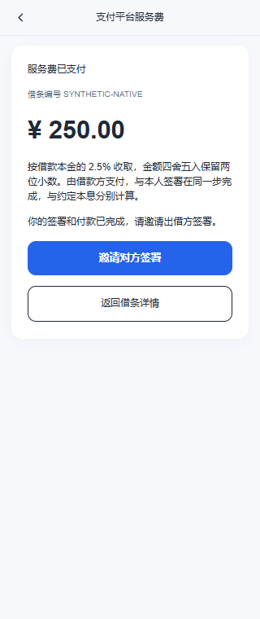

# 电子借条微信公众号直连支付

更新：2026-10-13。按用户确认方案实现：当前只接微信支付普通商户 APIv3，斗拱旧代码保留但默认不启用。支付凭据已加密配置，按用户要求默认启用微信支付，真实授权、下单与通知仍待服务器部署后实机联调。

## 主表与服务费

不新增支付表。复用 `iou_note.service_fee`，只新增两个字段：

| 字段 | 类型 | 含义 |
| --- | --- | --- |
| `payment_order_no` | varchar(32)，可空，唯一索引 | 当前微信商户订单号 `out_trade_no`，服务端生成并在下单前保存 |
| `service_fee_pay_status` | tinyint，默认 0 | 0未支付、1处理中/待确认、2已支付、3当前订单已关闭 |

已有库执行 [主表迁移](../sql/iou_wechat_payment_migration.sql)，前置为已有借条业务迁移；新库 `iou_note.sql` 包含同样字段和索引。该脚本不新增支付确认时间，不创建支付表，不给历史记录补收费。

默认服务费为本金 × **2.5%**，服务端 BigDecimal 四舍五入保留两位小数。例如本金 10,000 元，费用 250.00 元，与借款本金及利息分别展示。极小金额四舍五入为零时无需支付，不擅自增加最低收费。

创建完整草稿及修改未签草稿时计算服务费，金额保存在 `service_fee`，规则快照复用已有 `active_sign_context`。重新打开草稿使用已保存费用；改配置不会改变它。修改本金并重新保存时同步重算。开始签署付款后，条款、费用、签署人和签名锁定，付款重试不重新计价。

历史已签免费借条继续免费，历史未含收费快照的草稿保留原费用，编辑保存后按新规则计算。未明确规则的历史非零服务费记录不自动接入新支付流程。

## 签署和付款

借款方手写签名并确认全部条件，点击“签署并支付”后：

1. 后端校验实名身份、版本、预览摘要及还款计划。
2. 保存手写 PNG 和封存的确认凭证为**待完成签署**，借款方签署状态为 1，签署完成时间仍为空，不生成双方最终文件。已有签署上下文中的 `pendingBorrower` 关联付款方、原条款摘要及必要的分享定位串。
3. 对方接受邀请时暂存其身份作为本次付款签署的确定参与人，阻止另一个人抢占同一侧；这是身份预留，不是签署成功。
4. 自动进入支付页。后端锁住借条行，生成并保存微信商户订单号，再进行公众号授权和 APIv3 下单，前端调起原生微信收银台。
5. 后端通过查单或验签、解密支付通知确认付款，核对商户、公众号、订单号、金额、币种和付款 openid。
6. 在同一事务中将支付状态改为 2，核验待签署凭证及图片，完成借款方签署。根据出借方签署情况进入待对方签署或平台已生效状态。事务或文件保存失败时回滚，由通知重试或补偿查单恢复，不重复收费。

“同一步”是用户连续操作，不把外部支付放进数据库事务。待签名存在服务端，浏览器关闭不会丢失；客户端存储不保存签名、身份证或微信支付密钥。

### 两种发起顺序

| 发起方 | 顺序 |
| --- | --- |
| 借款方 | 填写并保存 → 准备签署并付款 → 后端确认已付、完成本人签署 → 邀请出借方 → 出借方签署 → 平台流程完成 |
| 出借方 | 保存并签署 → 邀请借款方 → 借款方准备签署并付款 → 后端确认已付、完成借款方签署 → 平台流程完成 |

借条业务状态 6 表示待完成签署付款；借款方先发起时，付款成功后 6→7，开放邀请；出借方先发起时付款成功后 6→2。原有免费流程不经过支付。

## 取消、复用和恢复

- 微信前端 `cancel` 只负责返回原签署页面，不上报“支付失败”，不删除订单或改变数据库签署完成状态。待签名保留，页面显示“继续完成签署付款”，无需重新签名。
- 前端成功也不能直接完成签署，必须读取后端已确认结果。
- 再次付款先查原单。原单未支付、未关闭且 Redis 里的预支付参数有效时，复用原订单调起收银台。
- 下单超时仍保留同一个商户订单号。短时间重复点击不重新发出下单；需要重试时使用相同订单号、金额、openid 和有效期，不能因为网络错误另生成新单。
- 预支付参数丢失或过期不等于订单关闭；重复下单返回商户订单号已使用时查原单，不认定失败。订单过期后先关单并查单确认 CLOSED，才允许新订单号替换旧号。
- 微信成功通知和主动查询均幂等。付款后直接关闭页面，通知或后台查单也会完成已准备的签署；刷新页面不会重新收费。
- 借条只保留当前支付订单。已确认关闭后才替换订单号；旧的已关闭订单通知不能改新单状态。没有历次支付明细表。
- 后台默认每分钟检查最多 20 张待确认借条，支付未配置或关闭时不查询数据库或调用微信。查单错误不转成已付或失败，不自动换单。

付款成功但出借方没有签署的退款问题，本期按用户要求**暂不处理**。保留已付款待签借条，不自助撤销或删除，不增加退款接口。

## 现有字段的内部复用

`terms_snapshot` 保存锁定条款及费用；`active_sign_context` 继续保存封存签署凭证，并增加内部 `fee`、`pendingBorrower` 和当前 `payment` 上下文。支付上下文保存本次商户、公众号、有效期、原 openid、提交/查单时间和已确认微信交易号；不新增对应主表列，不返回给普通详情或后台导出。

Redis 保存 10 分钟的一次性 OAuth state 和有效期内的 `prepay_id`。state 原子消费且绑定待签署人、借条和当前订单；用户不能提交任意 openid 或收费金额。商户订单号不等于微信 `transaction_id`，后者只在确认付款后记录到内部上下文。

## 接口

沿用上一轮 H5 路径名称以减少客户端变动，`fee-orders` 是当前借条支付信息的接口名称，**没有对应支付订单表**。

| 方法/路径 | 行为 |
| --- | --- |
| POST `/api/iou/app/notes/{id}/signatures` | 免费/出借方按原流程签署；收费借款方保存待付款签署 |
| POST `/api/iou/app/notes/{id}/fee-orders` | 借款方取得主表当前订单信息，重复调用复用；已关闭后可生成新号 |
| GET `/api/iou/app/fee-orders/{orderNo}` | 当事人查看当前订单，必要时查微信原单 |
| POST `/api/iou/app/fee-orders/{orderNo}/wechat-authorization` | 借款方获取一次性公众号授权地址 |
| POST `/api/iou/app/fee-orders/{orderNo}/payment` | 返回 AUTHORIZE、INVOKE、QUERY 或 PAID，只有 INVOKE 返回微信调起参数 |
| GET `/api/iou/payment/wechat/callback` | 匿名公众号回调，校验并消费 state 后自动回到支付流程 |
| POST `/api/iou/payment/wechat/notify` | 匿名 APIv3 支付通知，验签及 AES-GCM 解密，事务处理成功后返回 HTTP 204 |

只有借款方能发起付款；出借方可看同一借条订单；其他用户不能读。上述只保证已核验的业务账号发起付款，不另行保证微信钱包实名与身份证一致。

微信内 H5 使用 `WeixinJSBridge.invoke('getBrandWCPayRequest', ...)`。微信外、企业微信和小程序 WebView 提示在普通微信中打开。公众号 OAuth 回跳和首次签署使用一次性自动启动参数，取消/刷新不会无限自动弹起付款。

## 申请完成后的配置

当前使用普通商户 APIv3 与**微信支付公钥模式**，不自动下载平台证书。需要公众号与微信商户绑定、公众号网页授权域名、微信支付授权目录及可公开访问的 HTTPS 回调。

| 后端配置项 | 用途 |
| --- | --- |
| `iou.wechat-payment.enabled` | 当前默认 true；需关闭时显式设 false |
| `iou.wechat.app-id` / `iou.wechat.app-secret` | 自有公众号凭据，已保存为 Jasypt 密文；支付通过配置引用与分享功能共用 |
| `iou.wechat-payment.merchant-id` | 普通商户号 |
| `iou.wechat-payment.merchant-serial-no` | 商户 API 证书序列号，用于请求签名标识 |
| `iou.wechat-payment.private-key` | 商户 PKCS#8 私钥，PEM 或 Base64 |
| `iou.wechat-payment.api-v3-key` | 32 字节 APIv3 密钥，用于通知解密 |
| `iou.wechat-payment.wechatpay-public-key` | 微信支付公钥，PEM 或 Base64 |
| `iou.wechat-payment.wechatpay-public-key-id` | 对应 `PUB_KEY_ID_…` 微信支付公钥 ID，用于验签 |
| `iou.wechat-payment.notify-url` | 完整 HTTPS 地址，路径 `/api/iou/payment/wechat/notify` |
| `iou.wechat-payment.oauth-callback-url` | 完整 HTTPS 地址，路径 `/api/iou/payment/wechat/callback` |
| `iou.wechat.public-origin` | H5 HTTPS 来源，不带查询参数或片段 |
| `iou.notes.service-fee-policy` | 默认 ENABLED；需明确免收费时设 DISABLED |
| `iou.notes.service-fee-rate` | 默认 0.025，即 2.5%；未来调整只影响新保存草稿 |
| `iou.notes.service-fee-version` | 收费规则版本 |

签署仍需 `iou.notes.seal-key`，私有签名文件、数据库和封存密钥需一同备份。金额已按 2.5% 保存，但缺少支付配置时收费签署入口关闭，不进行真实扣款；历史免费邀请仍可按原流程签署。

部署顺序：执行主表迁移 → 配置凭据、绑定与域名 → `scripts/start-dev.ps1 -RestartBackend` 构建重启 → 微信实机验收。两个回调地址不能经过登录重定向。`#/…` 不计入微信支付授权目录。

2026-10-12 已按用户要求在配置中的 `eladmin` 数据库执行 `sql/iou_wechat_payment_migration.sql`，新增两个支付字段及对应索引并核验。执行前已备份借条主表至本机私有 `.codex-local/iou-note-before-1791797730866.sql`；迁移前后借条均为 3 条、还款计划均为 14 条。没有启动或重启后端，没有实际收费；真实验证仍需申请完成后的商户与公众号配置。

2026-10-13 已核验商户 API 证书与私钥匹配、证书有效、公钥为 RSA 2048 位及 APIv3 密钥格式。上述六项商户配置已写入 `application.yml`，均为 Jasypt `ENC(...)` 密文；私钥和公钥使用 Base64 编码后加密。支付与分享共用公众号凭据和正式来源，回调地址已配置默认值。用户已确认 JSAPI 权限、公众号关联、HTTPS 支付授权目录、网页授权域名及公钥模式启用。按用户要求支付开关已默认开启，尚未进行真实下单、支付通知或实机验收。发布服务器须使用现有 `JASYPT_ENCRYPTOR_PASSWORD`；分享、支付、费率、协议链接均直接在配置文件控制，不再使用 IOU 环境变量占位；封存密钥沿用本机已有值并加密写入 `iou.notes.seal-key`。服务器无需单独设置封存密钥环境变量。

## 正式域名配置

正式 H5 来源为 `https://ajc.tingnichui.com`。后端通过同域 `/api/` 提供服务时，`application.yml` 按以下地址配置：

- `iou.wechat.public-origin=https://ajc.tingnichui.com`
- `iou.wechat-payment.oauth-callback-url=https://ajc.tingnichui.com/api/iou/payment/wechat/callback`
- `iou.wechat-payment.notify-url=https://ajc.tingnichui.com/api/iou/payment/wechat/notify`
- `iou.wechat.image-url` 未设置时自动使用正式来源下的 `/wechat-invitation.png`；若显式设置了旧域名则同步更新。

公众号 JS 接口安全域名填写 `ajc.tingnichui.com`；上述 OAuth 回调使用同域时，网页授权域名也填写 `ajc.tingnichui.com`，按平台要求部署域名校验文件。JSAPI 支付授权目录按根路径哈希路由配置为 `https://ajc.tingnichui.com/`，不包含 `#/…`。服务器出口 IP 不变时无需因域名切换修改 IP 白名单。

域名切换后浏览器同源存储不会共享，用户需要在新域名重新登录。不要用跳转替代旧订单通知入口：旧域名已有支付订单时，应保留原通知地址可用直到订单处理完成。

## 斗拱保留边界

`IouHuifuGateway`、`IouPaymentOptions`、旧 `IouFeePaymentService`、旧域对象/Mapper、测试及 `sql/iou_fee_payment.sql` 保留。旧业务服务和通知入口以 `iou.payment.huifu-legacy-enabled=false` 关闭，当前用户接口固定走微信直连。

**当前部署不执行旧斗拱建表脚本，不启用旧开关。** 后续接入斗拱时再按实际业务流程适配，不能直接打开旧开关就混用当前主表订单。

## 验证与官方依据

聚焦测试涵盖 2.5% 保存冻结、历史免费、付款前签署状态、签名持久化与封存、付款后完成签署、原订单复用、请求签名、响应验签、通知解密、金额/商户/openid 核对、一次性授权、超时不换单、确认关单后换单及斗拱默认关闭。

浏览器验证只使用隔离会话和合成接口，不能代替真实微信、签名通知和商户联调。

本次验证结果：149 项后端 IOU 测试、37 项 H5 单元测试通过，H5 的类型检查、ESLint、Stylelint 和生产构建通过。隔离浏览器完成 7 个场景：借款方受邀签署付款、取消返回签署页、借款方发起并付款、出借方不能付款、微信外浏览器提示、未知支付状态不重复建单，以及历史免费借条不收费。移动端 320px 宽度检查无横向溢出。

以下为合成数据的付款成功页面，借款方签署完成后等待出借方签署：

- [微信 JSAPI 下单](https://pay.wechatpay.cn/doc/v3/merchant/4012791856)
- [JSAPI 开发指引与订单状态](https://pay.wechatpay.cn/doc/v3/merchant/4012791870)
- [前端回调可靠性](https://pay.wechatpay.cn/doc/v3/merchant/4012791869)
- [支付成功通知](https://pay.wechatpay.cn/doc/v3/merchant/4012791861)
