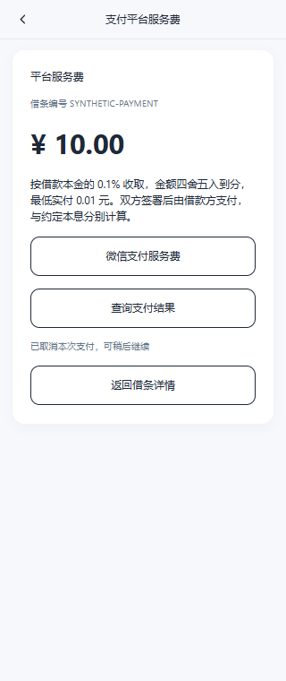

# 电子借条服务费与汇付微信支付

> 历史方案留档：用户已确认当前只接微信公众号直连，主表仅增加订单号和支付状态，不新增支付表；斗拱相关代码保留但默认不启用。当前实现、SQL 与配置请看[微信原生支付](./电子借条微信原生支付.md)，以下是早期斗拱方案记录，不作为当前部署指引。

更新：2026-10-12。代码已接入，真实收费默认关闭；公众号和汇付商户申请完成后，执行 SQL、配置凭据与收费规则，再进行微信实机联调。

## 已确认的业务规则

- 服务费按借款本金比例收取，由借款方承担，无论谁发起借条。
- 具体比例尚未指定，代码不设置正式收费比例。最低收费默认零，最高收费可不设置；正数收费四舍五入到分后最低实付 0.01 元。
- 草稿及服务端试算展示当前收费规则；首次签署固定规则版本、比例、上下限和金额。之后调整配置不会改变已签借条的价格。
- 历史已签免费借条继续免费。服务费与本金、利息和还款计划分别计算，汇付扣取的交易手续费也不等于平台服务费。
- 借款方在同一步点击“签署并支付”：先幂等保存签署，再自动进入微信授权、下单和原生支付。收费借条在借款方签署后进入状态 6，不等待出借方签署才付款。
- 支付确认与另一方签署是两个独立条件。借款方先发起时，支付成功后 6→7，才开放邀请出借方；出借方签完且借款方已付后 7→2。出借方先发起时，借款方签署并支付成功后 6→2。
- 状态 2 沿用现有“已生效”标签，表示平台流程完成，不以服务费付款记录代替借款交付证明或判断双方已签约定的法律效力。
- 双方签署记录及最终文件保持可查看、下载；付款不重写任何原签文件和最终文件。

## 两种发起方式

出借人发起：出借人签署 → 分享邀请 → 借款人核对条件及费用，点击“确认签署并支付” → 自动微信授权和原生支付 → 后端确认支付 → 平台流程完成。

借款人发起：借款人点击“签署并支付” → 自动微信授权和原生支付 → 后端确认付款 → 邀请出借人 → 出借人签署 → 平台流程完成。出借人无需再次付款。

借款人先发起时会在出借人签署前收费。已付款但出借人未签的借条保留为待对方签署，不自动生效，也不提供会丢失已付款记录的自助撤销或删除；退款规则及线上退款仍需另行确定。支付取消或超时保留已保存签署供继续付款，不要求重新签名，只有已确认关闭的支付尝试才允许重新下单。

“同一步完成”是用户交互流程：签署数据和外部支付不能放在同一个数据库事务中。前端签署成功后自动启动付款，OAuth 回跳自动继续调起支付；取消后清除自动启动参数，刷新不会自动重复弹起支付。

## 本次选用的支付方式

实现为自有公众号的微信内网页 JSAPI 原生支付：`T_JSAPI`。需要申请具备相应权限的公众号，并完成公众号 AppID 与汇付微信商户的关联、授权目录和网页授权域名配置。

汇付托管收银台是另外一条可选接入路线，当前代码没有混入托管的预下单参数或回调模型。若以后选择托管，需要切换支付适配器并核对商户的托管项目及授权要求；不能认为托管天然免除公众号配置。

| 用途 | 本次接口 |
| --- | --- |
| 下单 | `POST /v4/trade/payment/create` |
| 查单 | `POST /v4/trade/payment/scanpay/query` |
| 关闭未付交易 | `POST /v2/trade/payment/scanpay/close` |

下单的微信扩展参数在 `method_expand` 的 JSON 字符串中，包含 `sub_appid` 和本次公众号授权取得的 `sub_openid`。旧版聚合 `jspay/wx_data` 和托管 `preorder/hosting_data` 不适用于本实现。

后端请求使用 UTF-8 JSON、SHA256withRSA 签名，同步响应按排序后的数据体验签；`notify_url` 通知对原始 `resp_data` 验签，不重新排序。前端使用返回的 `pay_info` 调用 `WeixinJSBridge.invoke('getBrandWCPayRequest', ...)`，无需把商户私钥或公众号 AppSecret 发给浏览器。

微信外浏览器、企业微信和小程序 WebView 本期不提供原生支付入口，提示在普通微信中打开。不是微信外的 H5/MWEB 支付，也不是小程序 `wx.requestPayment`。

## 数据库与订单处理

执行 [支付表初始化](../sql/iou_fee_payment.sql)，已有库先完成现有借条业务迁移。该脚本创建两张表，并给 `iou_note` 增加可空的 `service_fee_paid_at` 支付确认时间；新库 `iou_note.sql` 也包含该列。付款事务更新该时间，签署事务读取它，避免把“借款方已付、出借方未签”误记为完成。不给历史免费借条补收费订单。

| 表 | 用途 |
| --- | --- |
| `iou_fee_order` | 一张借条一张服务费订单，固定金额、借款方用户、签署快照、微信授权状态及已付状态 |
| `iou_payment_attempt` | 每次汇付下单的日期和请求流水、返回流水、调起参数、有效期与查单记录 |

一张借条只有一张服务费订单（数据库唯一索引）。付款请求先在事务中保存 `SUBMITTING`，提交后才调用汇付。重复点击复用现有支付尝试；网络超时保留原请求日期和流水，不另外下单。

支付尝试状态：`SUBMITTING` / `PENDING` / `READY` → `SUCCESS`、`FAILED` 或 `CLOSED`。只有汇付查单确认失败或关单成功后才能新建尝试，不能凭本地超时或微信取消回调创建新单。新尝试金额仍使用原服务费订单。

汇付成功查单必须同时匹配商户号、请求日期、请求流水和订单金额；返回渠道或全局流水存在时也核对。在同一数据库事务中更新服务费订单、支付尝试和借条状态，重复查单不会重复更新生效时间、版本号或签署文件。

通知验签后只持久化“需要查单”的标记并按要求回复 `RECV_ORD_ID_` + 请求流水号，避免在汇付通知的 5 秒窗口内等待外部请求。查询页面和后台补偿任务会主动查单；最终结果不依赖用户回到页面。

补偿任务默认每分钟扫描最多 20 个待确认尝试。关闭支付或缺少配置时不访问支付表或汇付。查询异常只保留待确认状态；持续异常需要核对汇付交易记录，不通过人工修改借条状态伪造支付。

## 微信授权与身份边界

只有实名登录的借款方能创建服务费订单、申请微信授权和发起支付。出借方可读该借条对应的订单，但不能付款；其他用户不能查看。

授权状态为服务端生成的一次性随机串，数据库只保存 SHA256，10 分钟有效，关联具体服务费订单；回调先原子消费状态再兑换公众号 openid。浏览器不能提交任意 openid 或金额。回跳地址由服务端配置，不能由客户端传入外部网址。

这保证付款操作由借款方的已登录业务账号发起，不自动证明微信钱包实名与借款方身份证一致。本期没有另外开通汇付微信付款人实名强校验。

## 用户接口

前四个接口使用现有 H5 登录和用户端访问策略，返回 `Cache-Control: no-store`。

| 方法/路径 | 行为 |
| --- | --- |
| POST `/api/iou/app/notes/{id}/fee-orders` | 借款方取得唯一服务费订单，金额由服务端读取 |
| GET `/api/iou/app/fee-orders/{orderNo}` | 当事人查询订单，必要时触发服务端查单 |
| POST `/api/iou/app/fee-orders/{orderNo}/wechat-authorization` | 借款方取得本次公众号授权跳转地址 |
| POST `/api/iou/app/fee-orders/{orderNo}/payment` | 返回 `AUTHORIZE`、`INVOKE`、`QUERY` 或 `PAID`；只有 `INVOKE` 返回支付参数 |
| GET `/api/iou/payment/wechat/callback` | 匿名公众号授权回调，必须校验一次性 state |
| POST `/api/iou/payment/huifu/notify` | 匿名汇付通知，接受表单 `resp_data` 与 `sign` 并验签 |

匿名回调没有登录令牌校验，但不接受客户端声称的“已支付”。它们也不使用管理员 CRUD 接口。

H5 路由为 `/#/notes/payment?noteId=…&orderNo=…`；未产生订单时只需 `noteId`。首页单独统计并提示借款方的待付服务费，列表菜单和详情可继续付款，不混入原“待我确认”口径。已付页面可恢复成功状态，取消时可继续付款，结果延迟时提供查单并有限轮询；离开页面停止轮询。支付页面的微信回调仅用于提示，确认结果仍读取后端。

## 申请完成后的配置

以下变量仅配置在后端环境变量或本地加密配置中，不写入 H5 `.env`、仓库或公开日志。

| 变量 | 配置 |
| --- | --- |
| `IOU_PAYMENT_ENABLED` | 完成全部配置并准备联调时设 `true`，默认 `false` |
| `IOU_SERVICE_FEE_POLICY` | 正式开启收费设 `ENABLED`，默认 `DISABLED` |
| `IOU_SERVICE_FEE_RATE` | 小数比例，如 `0.001` 表示 0.1%；这是示例，不是已确认价格 |
| `IOU_SERVICE_FEE_MIN` | 最低收费元，默认 `0.00` |
| `IOU_SERVICE_FEE_MAX` | 最高收费元，默认不设置 |
| `IOU_SERVICE_FEE_VERSION` | 收费规则版本；调整定价时同步更新 |
| `IOU_HUIFU_SYS_ID` | 汇付系统号 |
| `IOU_HUIFU_PRODUCT_ID` | 汇付分配的产品号 |
| `IOU_HUIFU_MERCHANT_ID` | 收取平台服务费的汇付商户号 |
| `IOU_HUIFU_PRIVATE_KEY` | 商户 PKCS#8 RSA 私钥，可为 PEM 或 Base64 |
| `IOU_HUIFU_PUBLIC_KEY` | 汇付 X.509 RSA 公钥，可为 PEM 或 Base64 |
| `IOU_WECHAT_APP_ID` | 申请完成并绑定的公众号 AppID，与分享功能共用变量 |
| `IOU_WECHAT_APP_SECRET` | 公众号 AppSecret，与分享功能共用变量 |
| `IOU_WECHAT_PUBLIC_ORIGIN` | H5 HTTPS 来源，不带查询或片段，例如 `https://lexiangjie.com` |
| `IOU_WECHAT_PAY_CALLBACK_URL` | 后端完整 HTTPS 授权回调地址，路径 `/api/iou/payment/wechat/callback` |
| `IOU_HUIFU_NOTIFY_URL` | 后端完整 HTTPS 汇付通知地址，路径 `/api/iou/payment/huifu/notify` |
| `IOU_HUIFU_GATEWAY_URL` | 默认 `https://api.huifu.com`；联测地址必须使用汇付实际提供的地址 |

`IOU_NOTE_SEAL_KEY` 继续用于现有签署凭证。缺少收费比例、支付凭据、有效 RSA 密钥或 HTTPS 配置时，收费签署不会开放；默认关闭收费的原签署流程继续可用。

部署顺序：执行迁移 SQL → 配置公众号和汇付商户 → 设置真实凭据及收费规则 → 用 `scripts/start-dev.ps1 -RestartBackend` 构建重启 → 在微信内用测试借条验证。不得从借条模块手动拼接 Maven 启动命令。

公网反向代理需转发两个 `/api/iou/payment/…` 回调且不重定向，汇付通知地址不带查询参数；公众号网页授权回调域名对应后端回调所在域名，微信支付授权目录对应实际 H5 页面 URL，哈希 `#/…` 不是支付授权目录。

申请时应向汇付描述真实的“电子借条平台服务费、按本金比例计算”业务、收款主体及收费规则，核对获批产品版本和商户权限。代码完成不能替代实际进件和商户开通。

## 当前边界与验收

- 未创建公众号、未提交真实商户申请、未设置真实支付密钥、未进行真实扣款。
- 未执行本次支付 SQL、未修改开发库借条、未启用收费、未重启后端；申请完成后按部署顺序操作。
- 本期没有借款本金资金流转、自动还款、分账、在线退款或退款后台；需要退款时先按汇付控台实际交易办理并另行建设退款状态流程，不能把已支付订单改回未支付来退款。
- 后端单元测试覆盖比例金额与上下限、收费快照、历史免费兼容、借款方权限、重复创建、超时不重复下单、通知只触发查单、金额/商户/流水核对、查单生效幂等、关单确认和一次性授权。
- H5 测试覆盖微信环境、原生回调取消/失败、收费展示、签署前价格变化检查；浏览器验收全部使用隔离会话和合成接口，不写真实用户数据。
- 实机验收仍需覆盖微信授权、AppID 与商户绑定、支付授权目录、成功及取消、汇付异步通知、网络超时、补偿查单、支付到期关单和再次支付。

已运行：后端 `eladmin-system` 及依赖模块 Java 8 编译、126 项 `Iou*Test`（借条模块 76 项，系统模块 50 项）；H5 37 项测试、类型检查、ESLint、Stylelint、生产构建。浏览器合成验证借款方成功付款、取消恢复、出借方等待、微信外提示、已付恢复、免费状态及 320px 布局；没有页面异常或横向溢出。

## 官方依据

- [汇付官方聚合下单资料](https://github.com/huifurepo/dg-payment-skills/blob/main/huifu-pay-integration/references/aggregation-order.md)
- [微信场景扩展字段](https://github.com/huifurepo/dg-payment-skills/blob/main/huifu-pay-integration/references/aggregation-order-method-wechat.md)
- [聚合交易查询](https://github.com/huifurepo/dg-payment-skills/blob/main/huifu-pay-integration/references/aggregation-query-payment-query.md)
- [关单接口与终态判断](https://github.com/huifurepo/dg-payment-skills/blob/main/huifu-pay-integration/references/aggregation-query-trade-close.md)
- [汇付签名、API 版本及通知规范](https://github.com/huifurepo/dg-payment-skills/blob/main/huifu-pay-integration/references/aggregation-java-tech-spec.md)
- [notify_url 异步规范](https://github.com/huifurepo/dg-payment-skills/blob/main/huifu-pay-integration/references/shared-async-notify.md)
- [微信 JSAPI 调起支付](https://pay.wechatpay.cn/doc/v3/merchant/4012365339)
