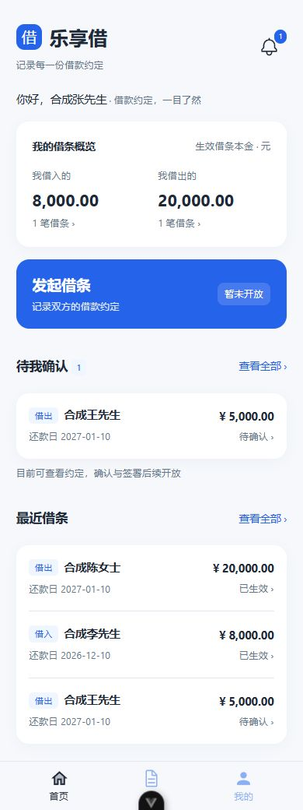
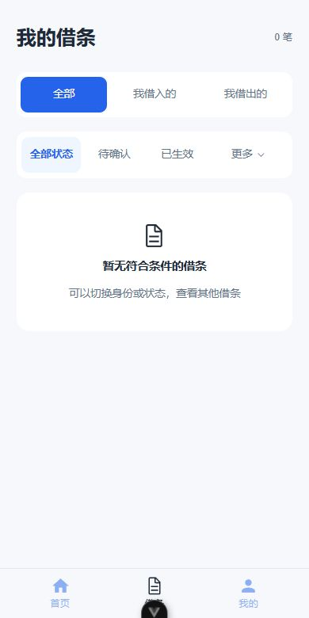
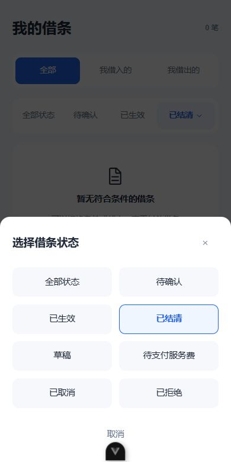
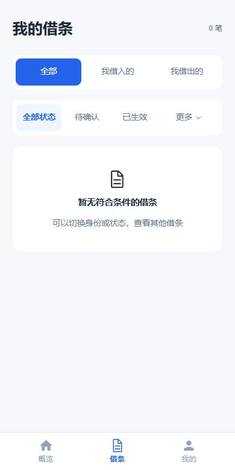

# 电子借条用户主页

## 第一版范围

H5 位于 `eladmin-h5/apps/iou`，采用概览优先布局，沿用注册、登录的乐享借主题。
登录与注册成功默认进入首页 `/`，登录仍保留安全的站内 redirect。

- 概览 `/`：我借入的、我借出的生效借条本金与笔数，待我确认的借条，最近三张借条。底部导航为“概览 / 借条 / 我的”，白底、选中主题蓝并稍加粗、未选中灰色。
- 我的借条 `/notes/`：全部、借入、借出身份筛选与分页查询。白底状态栏直接显示全部状态、待确认、已生效及更多入口；更多打开底部面板，以两列展示全部状态。选择后关闭面板，其他状态在入口回显并高亮，取消保留原筛选。每页二十条，支持加载更多。
- 借条详情 `/notes/:id`：双方姓名、金额、年利率、借款日期、还款日期、用途、备注及时间记录。
- 我的 `/user/`：个人资料、认证信息、我的借条、协议与隐私和退出登录。
- 个人资料 `/user/profile`、认证信息 `/user/verification`：读取本人资料，分别展示用户编号、姓名、手机号绑定状态、二要素核验状态。
- 协议与隐私 `/user/policies`：读取后端当前发布的用户协议、隐私政策与核验授权，不代表重新签署。

首页“发起借条”已接入 `/notes/create`，支持三步填写、还款试算和借条预览，见[电子借条发起页面](./电子借条发起页面.md)。真实创建、编辑、确认、签署、还款、支付、人脸与活体核验均未实现。帮助反馈与独立消息系统没有可用接口，第一版不添加无效入口；首页铃铛直达待我确认的借条。

## 查询接口

所有用户端借条查询均为 GET，位于 `/api/iou/app/`，要求启用的 IOU 账号。
服务端使用当前登录的 sys_user ID 查询 iou_user，要求二要素核验通过并有有效身份证 HMAC。
不接受客户端指定其他用户编号、证件或关联散列。

| 接口 | 参数 | 响应 |
| --- | --- | --- |
| `/summary` | 无 | borrowed、lent 中的 count 和 principal，以及 pendingCount |
| `/notes` | role=all/borrower/lender、可选 status=0..6、pending=true/false、page、size | content、totalElements |
| `/notes/{id}` | 借条编号 ID | 本人参与借条的必要详情 |

分页从 1 开始，size 最大 50，默认 20；固定按 create_time、id 倒序。
查询必须匹配本人作为借款人或出借人的 HMAC，草稿还要求发起人是本人。
不存在或不属于本人的详情统一报“借条不存在或无权查看”，不提供任意借条探测入口。
响应不包含身份证、身份证密文、HMAC、发起人关联 ID 或协议文件存储地址。
bigint 标识与金额以字符串返回；前端金额使用字符串分组，不将本金转为浮点数。

## 展示口径

- 首页概览仅累计 status=2（已生效）的本金，不表示实时待还或待收余额。
- 点击概览跳转到对应身份且已生效的列表；返回详情时保留原筛选。
- 待我确认：status=1、由对方发起、本人对应的签署时间为空。仅供查询，后续状态机讨论完成后再核对最终规则。
- 用户端将 status=1 显示为中性的“待确认”，避免对双方都显示“待对方确认”。后台字典保持原有值。
- 无借条时显示零金额与空状态；加载失败显示重试，不把查询失败伪装为零金额或空列表。
- 认证信息单独描述姓名与身份证号二要素核验，不把它显示为已完成人脸或电子签署。

## 验证记录（2026-10-11）

- H5 ESLint、Stylelint、vue-tsc 与生产构建通过。构建仍有框架原有 PostCSS from 参数警告。
- 后端新查询测试十项及账号、登录、注册自动登录回归，共三十七项通过；覆盖身份限制、草稿可见性、待确认条件、分页输入、字段投影、大编号与金额精度。
- 通过 `scripts/start-dev.ps1 -RestartBackend` 构建重启。三个新查询接口匿名访问均返回 401。
- 浏览器使用隔离端口下的合成查询响应检查概览筛选跳转、借条详情、返回原筛选、个人中心及认证页，并核对 320px 窄屏布局。没有调用收费身份核验或创建真实借条。
- 新用户空状态正确显示零金额且收起待确认区域；接口失败显示重试且不显示虚假的零金额或空列表。
- 用户端查询沿用现有表，无数据库结构或权限种子 SQL 变更。

运行中的真实账号借条数据联调仍需有可用的本人借条记录；合成浏览器检查不替代实际签署、支付或借条状态机验收。

